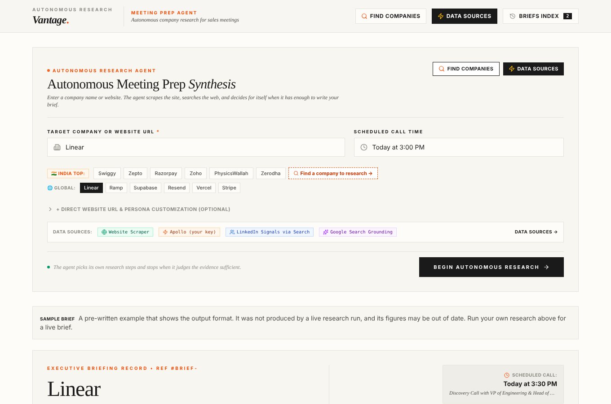

# Meeting Prep Agent

An autonomous research agent for sales meetings. Give it a company name (or website) and a meeting time, and it researches the company on the live web and writes a one-page brief: what the company does, recent signals, talking points, likely objections and discovery questions.

**Live demo:** https://meeting-prep-agent.ai.studio



## Why I built it

Before a sales call, a rep opens the prospect's website, LinkedIn page and news results, then turns all of that into a few talking points. This project hands that research loop to an AI agent and keeps a visible trail of what it looked at, so the rep can trust (or check) the brief.

## What makes it an agent

The research is not a fixed pipeline. After every step, the model reads the evidence gathered so far and decides two things:

1. **How sufficient is the evidence?** It returns a score from 0 to 100 with its reasoning.
2. **What next?** Either pick another tool and write the query for it, or stop and write the brief.

The loop ends when the model says it has enough (score of 85 or more) or after five tool runs. Every step streams to the browser in real time, and the full decision trail is saved with the brief in the Audit Trail view.

```
            ┌──────────────────────────────────────────────┐
            │                 Research loop                │
 company ─► │  run tool ─► model scores evidence ─► enough? │ ─► write brief
            │      ▲                                  │ no  │
            │      └────── model picks next tool ◄────┘     │
            └──────────────────────────────────────────────┘
```

## Data sources

| Source | How it works | Needs |
|---|---|---|
| Website scraper | Fetches the company's public web page over HTTP and parses title, meta description, headings, key paragraphs and tech clues with Cheerio | Nothing |
| Google Search grounding | Gemini with Google Search grounding, for funding, recent news and competitors | `GEMINI_API_KEY` |
| LinkedIn signals | Public headcount, hiring and leadership information found **through Google Search**. It does not log in to LinkedIn or use a LinkedIn API | `GEMINI_API_KEY` |
| Apollo.io (optional) | Calls Apollo's organisation enrichment API | Your own Apollo API key, entered in the app |

### Honest-data rule

A source either returns something it actually fetched, or it reports that it was unavailable. Nothing is filled in with placeholder data:

- If a tool cannot run (no key, rate limit, site blocked), the trail shows "No data" for that step and the model is told not to count it as evidence.
- The model is instructed to write "Not found in research" instead of guessing headcount, funding or revenue, and to list executives only when a source names them.
- With no Gemini key at all, the app falls back to a template brief and shows a clear **Heuristic Estimate Mode** banner on it.
- The two bundled example briefs (Linear, Ramp) are marked **Sample brief**.

## Other features

- **Company finder:** a small curated list (64 Indian companies and 12 global ones) plus live search results when a Gemini key is set.
- **Audio briefing:** reads a 90-second summary aloud using the browser's built-in speech synthesis.
- **Objection practice:** type your reply to an expected objection and get feedback. Scoring is rule-based (it checks for acknowledgement, reframing and a follow-up question), not AI-graded.
- **Export:** copy or print the brief.
- **History:** briefs are saved in the browser's local storage.

## Tech stack

- **Front end:** React 19, TypeScript, Tailwind CSS 4, Vite
- **Server:** Node.js, Express, Server-Sent Events for live progress
- **AI:** Google Gemini via `@google/genai` (default model `gemini-3.7-flash`, configurable)
- **Scraping:** Cheerio

## Run it locally

Requires Node.js 20 or newer.

```bash
git clone https://github.com/parth240931-oss/Meeting-Prep-Agent-AI-.git
cd Meeting-Prep-Agent-AI-
npm install
cp .env.example .env      # then add your Gemini API key
npm run dev               # http://localhost:3000
```

Get a Gemini API key at https://aistudio.google.com/apikey.

For a production build:

```bash
npm run build
NODE_ENV=production npm start
```

### Environment variables

| Variable | Required | Purpose |
|---|---|---|
| `GEMINI_API_KEY` | For live research | Gemini calls and Google Search grounding |
| `GEMINI_MODEL` | No | Override the model (default `gemini-3.7-flash`) |
| `PORT` | No | Server port (default `3000`) |

## Project structure

```
server.ts                 Express server, research loop, API routes
server/liveScraper.ts     Website scraper (blocks internal/private addresses)
server/connectors.ts      Apollo lookup and connector tests
server/companyDiscovery.ts  Company finder (curated list + live search)
server/indianCompaniesData.ts  Curated Indian company list
src/App.tsx               App shell, streaming client, local history
src/components/           Research form, live progress, brief view, modals
src/data/sampleBriefs.ts  The two bundled example briefs
```

## API

| Route | Purpose |
|---|---|
| `GET /api/research/stream` | Runs research and streams each agent step (SSE) |
| `POST /api/research` | Runs research and returns the finished brief |
| `GET /api/companies/search` | Company finder |
| `GET /api/scrape-website?url=` | Scrape one public page |
| `GET /api/connectors` | Which data sources are available on this server |
| `POST /api/connectors/test` | Test one data source |

## Limitations

- Sites that render with JavaScript or block bots give the scraper little to work with; the agent then relies on search.
- Search-grounded answers come from Gemini's reading of public sources. The brief is a starting point, so check key facts before a high-stakes call.
- Figures in the curated company list are approximate snapshots, not live data.
- There is no login or rate limiting. If you host it publicly, your Gemini key's quota is shared by everyone who uses it.
- The optional Apollo key is stored in the browser and sent to the server with each research request.

## How it was built

I designed the product, the research flow and the sales logic, and built the app with Google AI Studio's AI-assisted app builder, iterating on the generated code.

## Author

Parth Arora · [Portfolio](https://parth-portfolio-2026-08.vercel.app/) · [LinkedIn](https://www.linkedin.com/in/parth-arora-34440231a)
